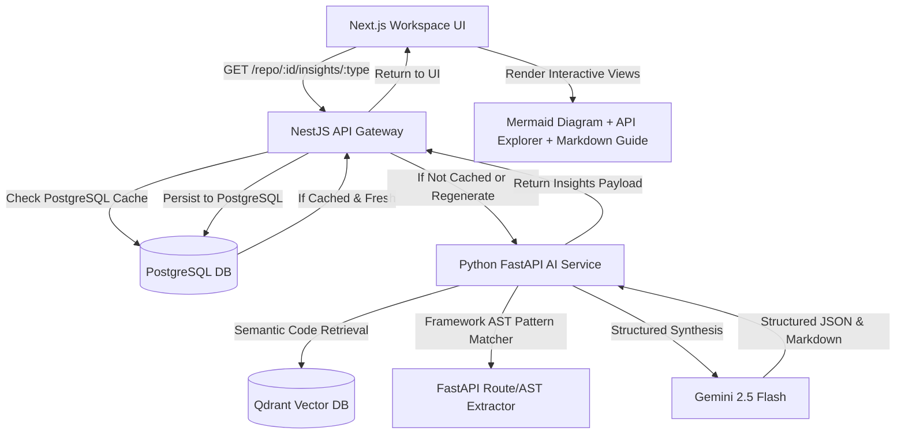

# Implementation Plan — Next Phase: Repository Intelligence Engine (Architecture, API Docs & Onboarding Guides)

## Goal Description
Following the foundational phases (Monorepo, Ingestion Pipeline, AST Chunking, Qdrant Vector Indexing, Branch Switching, and LangGraph Agentic RAG Chat), the next phase of **RepoMind AI** turns raw indexed code into actionable developer intelligence as outlined in the PRD:
1. **API Documentation Generator**: Automatic route parsing for NestJS, Express, FastAPI, Spring Boot, and Go; generating structured API specs with request/response payloads, authentication requirements, and direct code citations.
2. **Architecture Summary & Mermaid Visualizer**: Automated service decomposition, project layout mapping, module interaction diagrams using interactive **Mermaid.js**, and technology stack breakdown.
3. **Developer Onboarding Guide**: Step-by-step local setup, prerequisite analysis, environment variable requirements, and request lifecycle walk-through.
4. **Unified Repository Workspace UI**: A comprehensive repository dashboard tabbed view (`Architecture`, `API Docs`, `Onboarding`, and `Chat`).

---

## User Review Required

> [!IMPORTANT]
> **Generation Strategy (On-Demand vs. Ingestion-Time)**:
> We propose generating the **Architecture Summary**, **API Documentation**, and **Onboarding Guide** upon user request (with background caching in PostgreSQL) rather than during the initial ingestion. This keeps ingestion fast and prevents quota exhaustion on Gemini 2.5 Flash, while allowing users to regenerate docs when a branch changes.

> [!NOTE]
> **Storage Schema**:
> We will add an `insights` column or a dedicated `RepositoryInsight` entity in PostgreSQL to cache the generated Markdown and JSON documentation per repository and branch.

---

## Architecture & Data Flow



---

## Proposed Changes

### 1. Database & NestJS Gateway (`api`)

#### [NEW] `src/entities/repository-insight.entity.ts`
- Caches generated insights per repository and branch.
- Fields:
  - `id`: UUID
  - `repo`: Relation to `Repository`
  - `branch`: string
  - `architecture`: JSON/Text (Mermaid diagram code, system overview, module breakdown)
  - `apiDocs`: JSON (List of detected endpoints: method, path, handler, auth, params, file citation)
  - `onboarding`: Text (Markdown setup guide, env variables, request lifecycle)
  - `updatedAt`: Timestamp

#### [MODIFY] `src/entities/repository.entity.ts`
- Add one-to-one or one-to-many relation to `RepositoryInsight`.

#### [NEW] `src/insights/insights.module.ts`, `insights.controller.ts`, `insights.service.ts`
- Endpoints:
  - `GET /repo/:id/insights/architecture` (fetches cached or triggers generation)
  - `GET /repo/:id/insights/api-docs` (fetches route list & specs)
  - `GET /repo/:id/insights/onboarding` (fetches onboarding guide)
  - `POST /repo/:id/insights/regenerate` (forces re-analysis with current branch index)

---

### 2. Python AI Service (`ai-service`)

#### [NEW] `app/services/route_extractor.py`
- Framework-aware AST / regex route detector:
  - **NestJS**: `@Controller()`, `@Get()`, `@Post()`, `@Put()`, `@Delete()`, `@UseGuards()`, DTO references.
  - **Express / Fastify**: `app.get()`, `router.post()`, `router.use()`.
  - **FastAPI / Flask**: `@app.get()`, `@router.post()`, `@api_view()`.
  - **Go**: `r.GET()`, `http.HandleFunc()`, `router.HandleFunc()`.
  - **Spring Boot**: `@RestController`, `@GetMapping`, `@PostMapping`.

#### [NEW] `app/services/insights_generator.py`
- **Architecture Agent**:
  - Analyzes top-level modules, dependency graphs (`package.json`, `requirements.txt`, `go.mod`), and main entrypoints.
  - Synthesizes an interactive Mermaid.js diagram (`graph TD` or `sequenceDiagram`) and structured component descriptions.
- **API Docs Agent**:
  - Combines detected routes with code snippet context retrieved from Qdrant to generate request payloads, response schemas, and descriptions.
- **Onboarding Guide Agent**:
  - Gathers setup commands (`README.md`, `docker-compose`, scripts), parses `.env.example`, and drafts an actionable developer onboarding handbook.

#### [NEW] `app/routes/insights.py`
- Exposes:
  - `POST /ai/insights/architecture`
  - `POST /ai/insights/api-docs`
  - `POST /ai/insights/onboarding`

---

### 3. Next.js Frontend (`web`)

#### [NEW] `src/app/(main)/repo/[id]/page.tsx`
- Dedicated Repository Intelligence Workspace with tabs:
  1. **Architecture Tab**:
     - Interactive Mermaid.js diagram viewer (zoom, pan, export SVG).
     - Component breakdown cards with direct code citations.
  2. **API Documentation Tab**:
     - Searchable, filterable API Explorer (filter by HTTP Method: `GET`, `POST`, etc.).
     - Collapsible endpoint cards showing request parameters, payload schema, and code file links.
  3. **Onboarding Guide Tab**:
     - Formatted Markdown handbook with one-click copyable bash commands.
     - Environment variable table with keys and descriptions.
  4. **Chat Tab**:
     - Embedded codebase chat for this repository.

#### [NEW] `src/components/insights/MermaidViewer.tsx`
- Client-side dynamic Mermaid renderer using `mermaid.js` with dark/light mode support.

#### [NEW] `src/components/insights/ApiDocsExplorer.tsx`
- Interactive API endpoint list with method color pills, search bar, and schema view.

#### [MODIFY] `src/app/(main)/dashboard/page.tsx`
- Add direct navigation links to "Insights / Docs" on each repository card alongside "Codebase Chat".

---

## Verification Plan

### Automated Checks
```bash
# 1. NestJS build & lint
cd /Users/ritikkumawat/code-stuff/repomind-ai/api && npm run build

# 2. Next.js build & TypeScript verification
cd /Users/ritikkumawat/code-stuff/repomind-ai/web && npm run build

# 3. Python AI service endpoint health check
curl -X GET http://localhost:8000/health
```

### Manual Verification
1. **Import/Select Repository**: Select an indexed repository on the Dashboard.
2. **Generate Architecture**: Click "Architecture" tab $\rightarrow$ verify Mermaid diagram renders correctly and nodes reflect actual services/modules.
3. **Generate API Docs**: Click "API Documentation" tab $\rightarrow$ verify detected endpoints accurately list HTTP verbs, routes, and file citations.
4. **Generate Onboarding Guide**: Click "Onboarding" tab $\rightarrow$ verify step-by-step setup instructions and environment variable table.
5. **Switch Branch**: Switch the branch to a different branch $\rightarrow$ trigger "Regenerate" $\rightarrow$ verify updated docs reflect the selected branch.
